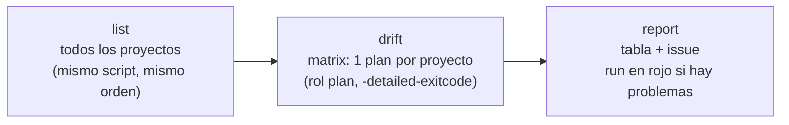

# 🔎 Workflow `check-terraform-drift.yml`: detección de drift de Terraform

El workflow [`check-terraform-drift.yml`](check-terraform-drift.yml) comprueba si lo que hay desplegado en AWS **coincide con el código de la rama `main`** en los proyectos de la plataforma ([`Serverless/ECS-Fargate/Terraform`](../../Serverless/ECS-Fargate/Terraform/README.md)).

Ejecuta `terraform plan` en cada proyecto con el **rol de plan (solo lectura)**. **Nunca cambia nada en AWS.** Si encuentra diferencias, abre un issue en GitHub con qué hacer en cada caso.

| 🧭 Ficha rápida | |
|---|---|
| **Qué revisa** | Los proyectos que gestiona el [pipeline de despliegue](README-terraform.md): VPC, ALB, cluster ECS, ECR y servicios |
| **Cuándo se ejecuta** | **Solo a mano** (*Run workflow*), desde la rama `main` |
| **Credenciales de AWS** | **OIDC**, rol de **plan** (solo lectura). El mismo que usa el pipeline de despliegue |
| **Resultado** | Tabla en el resumen del run, issue **"Drift de Terraform detectado"** y run en **rojo** si hay problemas |
| **Archivos** | [`workflows/check-terraform-drift.yml`](check-terraform-drift.yml) y [`scripts/terraform-changed-projects.sh`](../scripts/terraform-changed-projects.sh) (compartido con el pipeline) |
| **Nunca revisa** | El bucket del state (`S3-tfstate-backend-module`), `GitHub-OIDC-module` ni el Bastion (`EC2-bastion-host-module`) |

> 🗺️ Vista general de la plataforma: [README de Terraform](../../Serverless/ECS-Fargate/Terraform/README.md). Todos los workflows: [índice de `.github/`](../README.md).

---

## Índice

1. 💡 [¿Qué es el drift?](#qué-es-el-drift)
2. ▶️ [Cómo lanzarlo](#cómo-lanzarlo)
3. ⚙️ [Cómo funciona](#cómo-funciona)
4. 🚦 [Estados posibles](#estados-posibles)
5. 📝 [El issue de drift](#el-issue-de-drift)
6. 🚫 [Qué no revisa](#qué-no-revisa)
7. 🔒 [Requisitos y permisos](#requisitos-y-permisos)
8. 🧪 [Cómo probar cambios del workflow](#cómo-probar-cambios-del-workflow)
9. 🧰 [Problemas frecuentes](#problemas-frecuentes)

---

## ¿Qué es el drift?

Hay **drift** cuando lo que existe en AWS ya no coincide con el código de `main`. Por ejemplo:
- alguien cambió una regla de un security group en la consola;
- alguien borró un recurso a mano;
- hay código en `main` que nunca se aplicó.

> 💡 **Analogía:** es como comparar los **planos** de un edificio con el **edificio real**. Si alguien tiró una pared sin avisar, los planos ya no dicen la verdad. Este workflow hace la inspección y avisa de lo que no cuadra.

---

## Cómo lanzarlo

Solo se ejecuta **a mano**: *Actions → Check Terraform drift → Run workflow*, con la rama **`main`** seleccionada. No tiene parámetros: revisa siempre **todos** los proyectos que gestiona el pipeline.

> ⚠️ **Desde otra rama se detiene** con un error claro. El rol de plan solo confía en `main` y en los PR, y lo que tiene sentido es comparar AWS con el código de `main`.

**Cuándo lanzarlo:**
- Antes de un cambio importante, para empezar desde un estado limpio.
- Después de tocar algo a mano en la consola (por ejemplo, durante una incidencia).
- De forma periódica, como revisión de rutina.

---

## Cómo funciona



| Job | Qué hace |
|---|---|
| `list` | Pasa al [script de detección](README-terraform.md#detección-de-proyectos) **todos** los archivos de la plataforma (`git ls-files`), no solo los cambiados. Así obtiene todos los proyectos que gestiona el pipeline, con las mismas exclusiones y en el mismo orden |
| `drift` | Un job por proyecto, en paralelo. Ejecuta `terraform plan -detailed-exitcode`, que termina con **0** (sin cambios), **1** (error) o **2** (hay diferencias). Cuenta los recursos del state y clasifica el resultado. El plan completo queda en el resumen del job, para ver **qué** difiere |
| `report` | Junta los resultados en una tabla en el orden de la plataforma, gestiona el issue y deja el run en **rojo** si algún proyecto no está "sin drift" |

> 💡 **Si hay un `apply` en curso**, cada plan espera hasta 5 minutos a que se libere el bloqueo del state (`-lock-timeout=5m`). Lánzalo mejor cuando no haya despliegues: a mitad de un `apply` verías diferencias que solo son temporales.

---

## Estados posibles

| Estado | Cuándo | Qué hacer |
|---|---|---|
| ✅ **sin drift** | El plan no tiene cambios (código 0) | Nada |
| ⚠️ **drift** | El plan tiene cambios (código 2) y el state tiene recursos | Revisa el plan en el run. Si el cambio se hizo a mano en la consola, vuelve a aplicar el código ([workflow manual](README-terraform.md#workflow-manual) → `apply`). Si el cambio debe quedarse, llévalo al código con un PR |
| 🆕 **no desplegado** | El plan quiere crear todo: el state está vacío | Despliégalo con el [workflow manual](README-terraform.md#workflow-manual), en orden: VPC → ALB → cluster → ECR → servicios |
| 🔗 **falta una dependencia** | El plan falla con `Unable to find remote state` | Despliega antes el proyecto del que depende |
| ❌ **error** | El plan falla por otro motivo, por ejemplo una imagen que no está en el ECR. El detalle muestra el primer `Error:` | Revisa el log del job |

---

## El issue de drift

- **Hay problemas:** se crea un issue **"Drift de Terraform detectado"** con la tabla, qué hacer en cada caso y el enlace al run. Si ya hay uno abierto, se **actualiza**; nunca se duplica. El workflow lo reconoce por un marcador oculto (`<!-- terraform-drift -->`).
- **Todo sin drift:** si había un issue abierto, el workflow lo **comenta y lo cierra** solo.

---

## Qué no revisa

Lo mismo que el pipeline nunca toca: `S3-tfstate-backend-module`, `GitHub-OIDC-module` y `EC2-bastion-host-module`. Revísalos desde tu PC con `terraform plan`.

---

## Requisitos y permisos

- Las mismas variables del repositorio que el pipeline: `AWS_REGION` y `AWS_PLAN_ROLE_ARN` (ver [Configuración](README-terraform.md#configuración) y [Puesta en marcha](README-terraform.md#puesta-en-marcha-una-sola-vez)). Si falta el rol, el workflow avisa y no revisa nada. **No hace falta tocar el módulo OIDC.**
- Permisos del token de GitHub: `contents: read`; `id-token: write` (solo el job `drift`) e `issues: write` (solo el job `report`).
- Los resultados por proyecto se guardan como artefactos (`drift-<proyecto>`) durante 7 días.
- `concurrency: terraform-drift`: una revisión a la vez.

---

## Cómo probar cambios del workflow

Igual que con el pipeline, **sin AWS ni GitHub**:

1. **Sintaxis:** `actionlint .github/workflows/check-terraform-drift.yml` (con `shellcheck` instalado revisa también los `run:`).
2. **Lista de proyectos:** debe salir VPC, ALB, ECS-cluster, ECR y los servicios, sin el bucket, OIDC ni el Bastion:
   ```bash
   git ls-files Serverless/ECS-Fargate/Terraform | TF_ROOT=Serverless/ECS-Fargate/Terraform \
     .github/scripts/terraform-changed-projects.sh | jq -c '.plan | map(.name)'
   ```
3. **Clasificación e informe:** ejecuta el bloque `run:` de los pasos con un `plan.log` y JSON de resultados ficticios (códigos 0, 1 y 2; un proyecto sin resultado) y revisa la tabla y el número de problemas.

---

## Problemas frecuentes

| Síntoma | Causa | Solución |
|---|---|---|
| "Lanza este workflow desde la rama main" | Se lanzó desde otra rama | *Run workflow* con `main` seleccionada |
| Aviso "Faltan las variables del repositorio…" y no se revisa nada | Falta `AWS_PLAN_ROLE_ARN` (o `AWS_REGION`) | Ver [Puesta en marcha](README-terraform.md#puesta-en-marcha-una-sola-vez) |
| `Not authorized to perform sts:AssumeRoleWithWebIdentity` | El rol de plan no acepta el `sub` de `main` (repositorio o rama distintos) | Revisa `terraform output github_oidc_subjects` en [`GitHub-OIDC-module`](../../Serverless/ECS-Fargate/Terraform/GitHub-OIDC-module/README.md#problemas-frecuentes) |
| Un proyecto sale ❌ "Sin resultado: el job de este proyecto no terminó" | Su job se canceló o falló antes de guardar el resultado | Revisa el log de ese job |
| Todo sale ⚠️ drift justo después de un merge | El `apply` del pipeline aún no terminó o está esperando la aprobación | Espera a que termine el despliegue y vuelve a lanzarlo |
